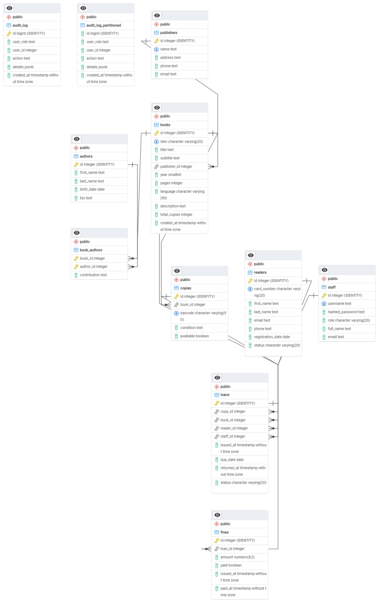

# 📚 Library System (PostgreSQL)

Проєкт реляційної бази даних для управління бібліотекою. Реалізовано нормалізовану схему (3НФ), бізнес-логіку на рівні SQL, розмежування прав та Docker-інфраструктуру з урахуванням ACID-вимог.

## 🛠 Стек технологій
* **СУБД:** PostgreSQL 16
* **Інфраструктура:** Docker, Docker Compose
* **Тестування:** Python 3.11 (`pytest`, `psycopg2`, `python-dotenv`)

## 📊 ER-Діаграма (Концептуальна модель)


## ⚙️ Архітектура та Виконання вимог
* **Нормалізація (3НФ):** Відсутність транзитивних залежностей (винесено `publishers`, `authors`). Атомарні атрибути.
* **ACID, Транзакції та Блокування:** Процедура `issue_book` використовує `SELECT ... FOR UPDATE`, `ROLLBACK` через `SAVEPOINT` та обробку винятків (`EXCEPTION`).
* **Безпека (RBAC):** 4 ролі за принципом найменших привілеїв: `library_admin`, `library_staff`, `library_operator`, `library_reader`.
* **Оптимізація та Партиціювання:** B-Tree індекси для частих вибірок. Таблицю `audit_log` секціоновано за часом.
* **Рівні ізоляції:** сценарії порівняння рівнів ізоляції у `9_isolation_levels.sql`.
* **Резервне копіювання:** `.bat` скрипт для створення логічних дампів БД (`pg_dump`).

## 📁 Структура проєкту
```text
Postgres_Pushnia/
├── docs/
│   └── ERD.png                         # ER-діаграма бази даних
├── init_sql/
│   ├── 1_init_db.sql                   # DDL, 3НФ, створення базових таблиць
│   ├── 2_queries_and_views.sql         # Складні вибірки та представлення
│   ├── 3_indexes_and_explain.sql       # Оптимізація запитів
│   ├── 4_functions_and_procedures.sql  # Бізнес-логіка (issue_book)
│   ├── 5_triggers.sql                  # Тригери (audit_log, перерахунок копій)
│   ├── 6_transactions.sql              # Сценарії ACID та блокувань
│   ├── 7_roles_and_permissions.sql     # RBAC ролі та користувачі
│   ├── 8_partitioning.sql              # Партиціювання audit_log
│   └── 9_isolation_levels.sql          # Порівняння рівнів ізоляції
├── test_db.py                          # Автотести тригерів та транзакцій
├── backup_script.bat                   # Скрипт бекапу (Windows)
├── .env.example                        # Шаблон змінних оточення
├── docker-compose.yml                  # Інфраструктура БД
├── .gitignore
└── requirements.txt                    # Залежності Python
```

## 🚀 Запуск та Налаштування

**Вимоги:** Docker Desktop (запущений) та Python 3.11.

**1. Клонування та змінні оточення**
```bash
git clone https://github.com/Pusna/Postgres_Pushnia.git
cd Postgres_Pushnia
cp .env.example .env
```

**2. Запуск бази даних**
```bash
docker-compose up -d
```
SQL-скрипти з `init_sql/` виконаються автоматично при першому старті. Зачекайте 10–15 секунд, поки база буде готова.

*Скидання БД до чистого стану:*
```bash
docker-compose down -v && docker-compose up -d
```

**3. Запуск тестів**
```bash
python -m venv venv
venv\Scripts\activate
pip install -r requirements.txt
pytest -v
```

## 📖 Доступ та Ролі
Підключення через DBeaver / pgAdmin: `localhost:5433`, база `library_db`.

| Логін | Пароль | Групова роль | Рівень доступу |
| :--- | :--- | :--- | :--- |
| `postgres` | з файлу `.env` | `superuser` | Абсолютні права |
| `admin_user` | `admin_123` | `library_admin` | Повні права в схемі public |
| `librarian_user` | `lib_123` | `library_staff` | Управління каталогом та бізнес-процесами |
| `operator_user` | `oper_123` | `library_operator` | Реєстрація видач та читачів (без зміни каталогу) |
| `reader_user` | `reader_123` | `library_reader` | Лише перегляд каталогу |


**Підключення під оператором через термінал:**
```bash
docker exec -it library_postgres psql -U operator_user -d library_db
```

**Приклад виклику процедури видачі книги** 
(копія №4, читач №2, співробітник №1, повернення через 14 днів):
```sql
CALL issue_book(4, 2, 1, CURRENT_DATE + 14);
```
Якщо копія вже видана, процедура поверне помилку. Вільні копії можна знайти так:
```sql
SELECT id FROM copies WHERE available = true;
```

## 💾 Резервне копіювання та Відновлення

Контейнер має бути запущений. Папка `backups/` не зберігається в репозиторії.

**Створення бекапу (Windows):**
Запустіть `backup_script.bat`. Він використовує `pg_dump` з прапорцем `-Fc` і створює файл `backups/library_backup.dump`.

**Відновлення (Restore):**
```bash
docker cp backups\library_backup.dump library_postgres:/tmp/restore.dump
docker exec -i library_postgres pg_restore -U postgres -d library_db --clean --if-exists /tmp/restore.dump
```